# Oracle Database 21c XE y SQL Developer

**Guía de instalación y configuración** · Windows 11 Pro

*Versión 1.0 · Noviembre de 2026 · Jorge Martínez*

---

## Índice

- [0. Introducción](#0-introducción)
- [1. Software necesario](#1-software-necesario)
- [2. Requisitos y verificación del equipo](#2-requisitos-y-verificación-del-equipo)
- [3. Preparación del equipo](#3-preparación-del-equipo)
   - [3.1. Punto de restauración](#31-punto-de-restauración)
   - [3.2. Rutas de instalación](#32-rutas-de-instalación)
   - [3.3. Comprobaciones previas](#33-comprobaciones-previas)
- [4. Instalación de Oracle Database XE](#4-instalación-de-oracle-database-xe)
   - [4.1. Descomprimir el instalador](#41-descomprimir-el-instalador)
   - [4.2. Ejecutar el asistente](#42-ejecutar-el-asistente)
   - [4.3. Carpeta de destino](#43-carpeta-de-destino)
   - [4.4. La contraseña de la base de datos](#44-la-contraseña-de-la-base-de-datos)
   - [4.5. Instalación](#45-instalación)
   - [4.6. Pantalla final](#46-pantalla-final)
- [5. Verificación del servidor](#5-verificación-del-servidor)
   - [5.1. Servicios de Windows](#51-servicios-de-windows)
   - [5.2. Servicio de escucha (listener)](#52-servicio-de-escucha-listener)
   - [5.3. Conexión con SQL*Plus](#53-conexión-con-sqlplus)
   - [5.4. Consola web EM Express](#54-consola-web-em-express)
- [6. Configuración posterior: inicio manual de servicios (Solo en equipos personales)](#6-configuración-posterior-inicio-manual-de-servicios-solo-en-equipos-personales)
   - [6.1. Cambiar el tipo de inicio a manual (usando el administrador de servicios)](#61-cambiar-el-tipo-de-inicio-a-manual-usando-el-administrador-de-servicios)
   - [6.2. Arrancar y parar los servicios](#62-arrancar-y-parar-los-servicios)
   - [6.3. Scripts para arrancar y parar con un doble clic](#63-scripts-para-arrancar-y-parar-con-un-doble-clic)
   - [6.4. Comprobación final](#64-comprobación-final)
- [7. Usuario de trabajo](#7-usuario-de-trabajo)
   - [7.1. Conectarse a XEPDB1 como administrador](#71-conectarse-a-xepdb1-como-administrador)
   - [7.2. Crear el usuario y darle permisos](#72-crear-el-usuario-y-darle-permisos)
   - [7.3. Comprobar que el usuario funciona](#73-comprobar-que-el-usuario-funciona)
   - [7.4. Ampliar, quitar o revisar permisos más adelante](#74-ampliar-quitar-o-revisar-permisos-más-adelante)
- [8. SQL Developer](#8-sql-developer)
   - [8.1. Descomprimir el programa](#81-descomprimir-el-programa)
   - [8.2. Primer arranque](#82-primer-arranque)
   - [8.3. Conexión como administrador](#83-conexión-como-administrador)
   - [8.4. Conexión con el usuario de trabajo y prueba](#84-conexión-con-el-usuario-de-trabajo-y-prueba)
- [9. Incidencias y ficheros de registro](#9-incidencias-y-ficheros-de-registro)
   - [9.1. Errores de conexión habituales](#91-errores-de-conexión-habituales)
   - [9.2. Incidencias durante la instalación y la configuración](#92-incidencias-durante-la-instalación-y-la-configuración)
   - [9.3. Ficheros de registro](#93-ficheros-de-registro)
- [10. Anexos](#10-anexos)
   - [10.1. Desinstalación](#101-desinstalación)
   - [10.2. Conceptos básicos: CDB y PDB](#102-conceptos-básicos-cdb-y-pdb)

---

## 0. Introducción

Este manual explica cómo instalar y configurar **Oracle Database Express Edition (XE)** y **Oracle SQL Developer** en un equipo con **Windows 11 Pro**, directamente sobre el sistema y sin máquina virtual.

Oracle XE es la edición gratuita de Oracle Database. Tiene las mismas bases que las versiones comerciales, pero con límites de uso (procesador, memoria y espacio de datos), y está pensada para aprender, desarrollar y hacer pruebas. SQL Developer es la herramienta gráfica gratuita de Oracle para trabajar con la base de datos.

El manual sigue el orden real del trabajo: comprobar los requisitos, preparar el equipo, instalar el servidor y verificarlo, configurar los servicios, crear un usuario de trabajo, conectar SQL Developer y, por último, resolver los problemas habituales.

**Convenciones:**

- Los comandos y los nombres de fichero aparecen en letra de ancho fijo.

- Durante la instalación se elige **una contraseña común para SYS, SYSTEM y PDBADMIN**. Es la que se usa para conectarse a la base de datos la primera vez, así que hay que guardarla en un lugar seguro.

## 1. Software necesario

Para disponer de un entorno de trabajo completo hacen falta dos programas, que cumplen funciones distintas:

| Programa | Función | Dónde se descarga |
|---|---|---|
| **Oracle Database 21c Express Edition (XE)** | **Servidor**: el sistema gestor de bases de datos que almacena los datos y atiende las peticiones. Funciona como un servicio de Windows, en segundo plano y sin ventana propia. | Página oficial de descargas de Oracle Database XE: [https://www.oracle.com/database/technologies/xe-downloads.html](https://www.oracle.com/database/technologies/xe-downloads.html) |
| **Oracle SQL Developer** | **Cliente**: una aplicación gráfica gratuita para conectarse al servidor, explorar sus objetos y ejecutar consultas sin usar la consola. | Página oficial de descargas de SQL Developer: [https://www.oracle.com/es/database/sqldeveloper/technologies/download/](https://www.oracle.com/es/database/sqldeveloper/technologies/download/) (variante para Windows de 64 bits con JDK incluido) |

Oracle Database 21c XE es la última versión publicada con el nombre “Express Edition”. Su sucesora gratuita se llama Oracle AI Database Free y está fuera del alcance de este manual.

Las dos descargas son gratuitas y directas según los enlaces de la tabla anterior, que pueden variar en el futuro.

Se recomienda comprobar la integridad del fichero descargado comparando su código SHA256 con el que publica Oracle en la página de descarga:

```
Get-FileHash .\<fichero_descargado>.zip -Algorithm SHA256
```

## 2. Requisitos y verificación del equipo

Antes de instalar, hay que comprobar que el equipo cumple los requisitos mínimos de Oracle Database XE. Los datos proceden de la guía oficial de instalación para Windows, y cada uno se comprueba con la orden indicada, ejecutada en **PowerShell**.

- **Sistema operativo:** Windows de 64 bits, edición Pro, Enterprise o Education. **Windows Home no está soportado.** Para comprobarlo:

```
Winver
```

- **Memoria RAM:** al menos 2 GB. Para ver la RAM total en GB:

```
(Get-CimInstance Win32_ComputerSystem).TotalPhysicalMemory / 1GB
```

- **Espacio en disco:** 8,5 GB para el programa, más 2 GB de espacio temporal. El espacio libre aparece en la columna *Free*:

```
Get-PSDrive C
```

- **Permisos:** el usuario debe ser miembro **directo** del grupo Administradores. Su nombre debe aparecer en la lista:

```
net localgroup Administradores
```

**Notas:**

- La guía oficial menciona Windows 10 y Windows Server, pero no Windows 11. La instalación descrita en este manual se ha realizado en Windows 11 Pro.

- Oracle XE es una edición gratuita con límites: usa como máximo 2 núcleos de CPU y 2 GB de RAM, admite hasta 12 GB de datos de usuario y solo permite una instalación por equipo.

## 3. Preparación del equipo

### 3.1. Punto de restauración

Antes de instalar se recomienda crear un punto de restauración de Windows. Si la instalación falla o deja el sistema en mal estado, permite volver atrás sin reinstalar Windows.

- En el menú Inicio, buscar **Crear un punto de restauración**.

- Si la protección del disco C: está desactivada, seleccionarlo, pulsar **Configurar** y marcar **Activar protección del sistema**.

- Pulsar **Crear**, escribir un nombre descriptivo (por ejemplo, *Antes de Oracle XE*) y confirmar

### 3.2. Rutas de instalación

**Las rutas deben ser simples y cortas, y no deben contener espacios, tildes ni la letra ñ.** Oracle propone por defecto una ruta que incluye el nombre del usuario de Windows, y si este tiene espacios o caracteres especiales, la instalación puede fallar. En este manual se usan estas rutas:

- `C:\xe_temp`: carpeta temporal donde se descomprime el instalador.

- `C:\oracle`: carpeta de instalación de Oracle Database XE.

- `C:\oracle\sqldeveloper`: carpeta de SQL Developer.

No es necesario crear estas carpetas ahora: cada una se crea en el paso correspondiente de la instalación.

### 3.3. Comprobaciones previas

El instalador falla si en el equipo hay restos de otra instalación de Oracle. Antes de empezar, conviene comprobar en **PowerShell**:

- **Que no existen las variables de entorno de Oracle.** Estas dos órdenes no deben mostrar nada:

```
echo $env:ORACLE_HOME
echo $env:TNS_ADMIN
```

- **Que los puertos que usará Oracle están libres:** el 1521, que usa el servicio de escucha (*listener*), y el 5500, que usa la consola web EM Express. Esta orden no debe mostrar ningún resultado:

```
netstat -ano | findstr ":1521 :5500"
```

## 4. Instalación de Oracle Database XE

### 4.1. Descomprimir el instalador

1. Hacer clic con el botón derecho sobre el ZIP descargado y elegir Extraer todo (si se hace con la propia función de Windows y no con software de terceros).

2. Como destino, escribir:

   ```
   C:\xe_temp
   ```

3. Esperar a que termine. NUNCA ejecutar el instalador desde dentro de un ZIP/elemento comprimido.

### 4.2. Ejecutar el asistente

1. Abrir `C:\xe_temp` y hacer doble clic en `setup.exe`.

2. Si Windows pregunta si se permite que la aplicación haga cambios en el equipo, responder **Sí**.

3. En la pantalla de bienvenida, pulsar **Siguiente**.

4. Aceptar los términos de la licencia y pulsar **Siguiente**.

### 4.3. Carpeta de destino

**No hay que dejar la carpeta que propone el instalador**, porque incluye el nombre del usuario de Windows. Pulsar **Cambiar** y escribir una ruta simple, sin espacios, tildes ni ñ:

```
C:\oracle\
```

<p align="center">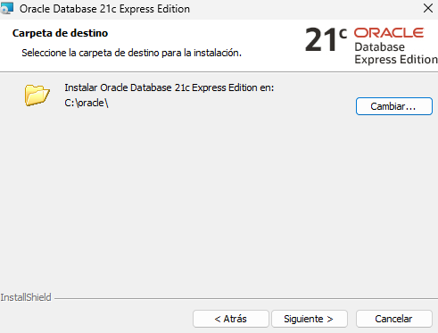</p>

### 4.4. La contraseña de la base de datos

El asistente pide **una sola contraseña**, que se asigna a la vez a tres cuentas de administración:

- `SYS`**:** el superadministrador. Controla toda la base de datos, incluido arrancarla y pararla.

- `SYSTEM`**:** el administrador habitual. Crea usuarios y gestiona permisos.

- `PDBADMIN`**:** el administrador de la base de datos de trabajo, llamada `XEPDB1`.

Es la contraseña con la que habrá que **conectarse la primera vez**, así que:

- Debe tener al menos 12 caracteres, mezclando mayúsculas, minúsculas y números.

- **Hay que apuntarla en un lugar seguro.** Si se olvida, recuperarla es complicado.

<p align="center">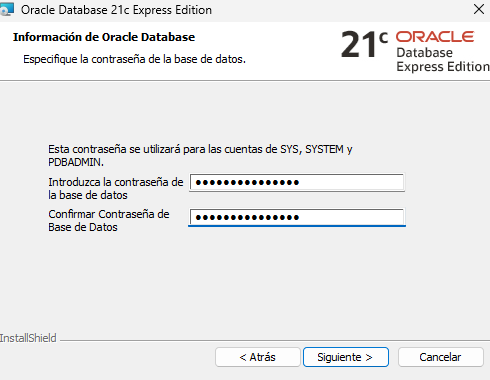</p>

### 4.5. Instalación

1. Revisar el resumen y pulsar **Instalar**.

2. Esperar a que termine. Conviene no usar el equipo para tareas pesadas mientras tanto. Se abrirá otra ventana con el progreso de la configuración de componentes. Se cerrará automáticamente al terminar. Este proceso es complejo y puede durar hasta 10 minutos en equipos potentes; el administrador de tareas no mostrará apenas actividad, aunque el programa de instalación funcione con normalidad, por lo que no es una medida confiable.

3. **Firewall de Windows** podría solicitar una acción por parte del usuario. Permitir el programa.

### 4.6. Pantalla final

La última pantalla muestra los **datos de conexión**. Hay que anotarlos antes de cerrarla; se usarán más adelante:

- Conexión al contenedor raíz: `localhost:1521`

- Conexión a la base de datos de trabajo: `localhost:1521/XEPDB1`

- Consola web de administración (EM Express): `https://localhost:5500/em`

Si la ventana se cerrara antes de anotarlos, pueden consultarse más adelante, como se explica en la sección 5.

Para terminar, pulsar **Finalizar**.

**Se puede borrar la carpeta `C:\xe_temp`; no hay que borrar nada de `C:\oracle`, que contiene la instalación.**

## 5. Verificación del servidor

Terminada la instalación, hay que comprobar que el servidor funciona. Se hace en cuatro pasos, de lo más básico (¿está encendido?) a lo más completo (¿se puede entrar y consultar?). Estas comprobaciones también sirven para recuperar los datos de conexión si se cerró la pantalla final del instalador sin anotarlos

### 5.1. Servicios de Windows

Oracle funciona como servicios de Windows. Para comprobar que están en marcha:

1. Pulsar **Windows + R**, escribir `services.msc` y pulsar **Intro**.

2. Buscar estos dos servicios y comprobar que su estado es `En ejecución`:

   - `OracleServiceXE`: la base de datos.

   - `OracleOraDB21Home1TNSListener`: servicio de escucha *(listener)*, que recibe las conexiones.

<p align="center">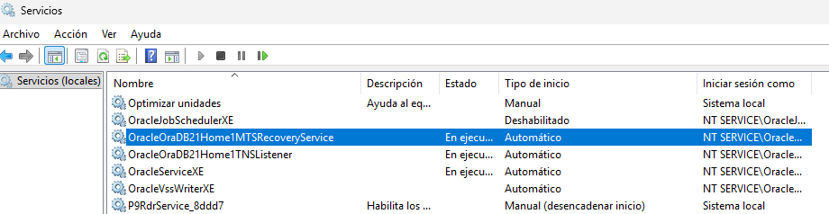</p>

### 5.2. Servicio de escucha (listener)

Es la “puerta” por la que entran las conexiones. Para comprobar que funciona y qué bases de datos atiende:

En PowerShell:

```
lsnrctl status
```

En el resultado deben aparecer:

- El **puerto 1521**, en la línea que empieza por *Escuchando en* o *Listening on*.

- Los servicios **XE** (el contenedor raíz) y **XEPDB1** (la base de datos de trabajo).

<p align="center">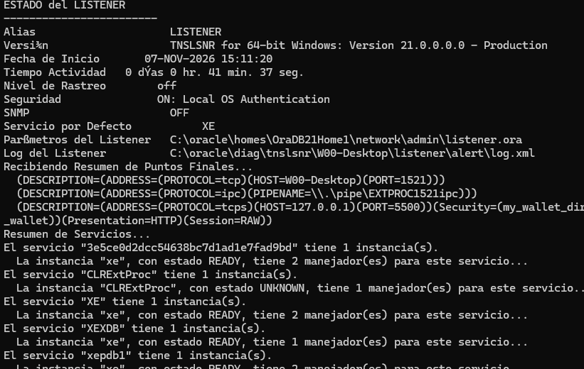</p>

Si PowerShell no reconoce la orden, hay que cerrarlo y abrir uno nuevo: el instalador añade las herramientas de Oracle a la configuración del sistema, pero las ventanas ya abiertas no han reconocido el cambio.

### 5.3. Conexión con SQL*Plus

SQL\*Plus es la herramienta de consola que se instala con Oracle para conectarse a la base de datos y escribir órdenes SQL. Se abre desde la misma ventana de PowerShell:

1. Escribir esta orden y pulsar **Intro**:

   ```
   sqlplus / as sysdba
   ```

Se conecta como administrador (SYS) sin pedir contraseña, porque Oracle reconoce al usuario de Windows que hizo la instalación.

2. Al entrar, el prompt cambia de `PS C:\...>` a `SQL>`. Esto indica que ya no se están escribiendo órdenes de Windows, sino para la base de datos. A partir de aquí, escribir una por una, pulsando **Intro** después de cada una:

   ```
   SELECT banner FROM v$version;
   SHOW PDBS
   SELECT dbms_xdb_config.gethttpsport FROM dual;
   ```

Las órdenes SQL (como `SELECT`) deben terminar en punto y coma; las órdenes propias de SQL\*Plus (como `SHOW` o `EXIT`) no lo necesitan. Si se olvida el punto y coma en una orden SQL, SQL\*Plus muestra un número de línea esperando que se complete: basta con escribir `;` y pulsar **Intro**.

Qué hay que comprobar en el resultado:

- La **primera** orden muestra la versión de Oracle instalada.

- La **segunda** muestra las bases de datos disponibles: **XEPDB1** debe aparecer con el estado **READ WRITE**, es decir, abierta y lista para trabajar.

- La **tercera** muestra el puerto de la consola web EM Express, normalmente **5500**.

3. Para salir de SQL\*Plus y volver a PowerShell:

   ```
   EXIT
   ```

Las órdenes no distinguen entre mayúsculas y minúsculas, pero las contraseñas y los textos entre comillas sí. Por convención, las palabras clave de SQL se escriben en mayúsculas para facilitar la lectura

<p align="center">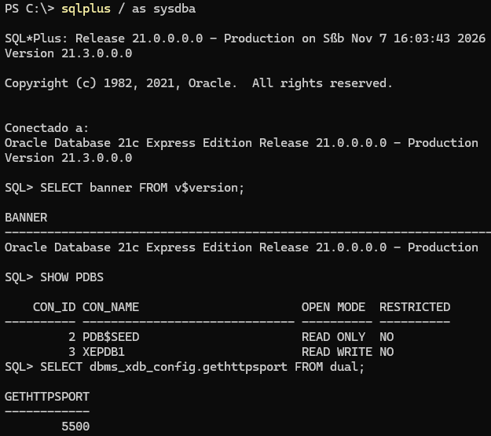</p>

### 5.4. Consola web EM Express

EM Express (*Enterprise Manager Express*) es una consola de administración que se instala con Oracle y se abre desde el **navegador web**, sin instalar nada más. Permite ver de un vistazo el estado de la base de datos, el uso de recursos y los usuarios. Por defecto **solo funciona desde el propio equipo** donde está instalado Oracle.

1. Abrir el navegador (Edge, Chrome, Firefox…) y escribir esta dirección en la barra de direcciones. Si en el apartado 5.3 salió un puerto distinto de 5500, hay que cambiarlo:

   ```
   https://localhost:5500/em
   ```

2. El navegador mostrará un aviso de que **la conexión no es privada o segura**. Es normal: EM Express usa un certificado creado durante la instalación, que el navegador no reconoce, pero la conexión no sale del propio equipo. Para continuar:

   - En **Edge** o **Chrome**: pulsar **Avanzado** y después **Continuar a localhost (no seguro)**.

   - En **Firefox**: pulsar **Avanzado** y después **Aceptar el riesgo y continuar**.

3. En la pantalla de inicio de sesión, rellenar:

   - **Nombre de usuario:** `system`

   - **Contraseña:** la elegida durante la instalación.

   - **Nombre del contenedor**: dejar en blanco. Así se entra en el contenedor raíz, que es suficiente para comprobar que todo funciona.

4. Pulsar **Iniciar sesión**.

Si aparece el panel principal, con el estado de la base de datos y gráficos de actividad, el servidor está funcionando correctamente y la verificación ha terminado.

<p align="center">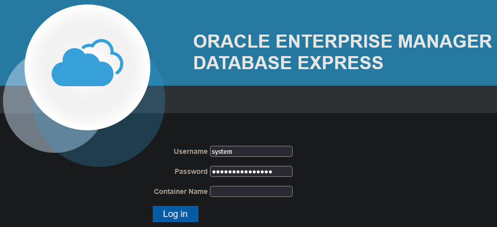</p>

## 6. Configuración posterior: inicio manual de servicios (Solo en equipos personales)

Por defecto, los servicios de Oracle **se inician automáticamente con Windows** y permanecen activos aunque no se esté usando la base de datos, reservando memoria y procesador. En un equipo de uso personal o de estudio, es preferible que solo se pongan en marcha cuando se vayan a utilizar.

### 6.1. Cambiar el tipo de inicio a manual (usando el administrador de servicios)

Tras la instalación aparecen cinco servicios de Oracle. Cuatro de ellos tienen inicio **Automático**:

- **OracleServiceXE:** la base de datos.

- **OracleOraDB21Home1TNSListener:** el servicio de escucha *(listener)*, que recibe las conexiones.

- **OracleOraDB21Home1MTSRecoveryService:** recupera transacciones en las que participan otros programas de Windows. No es necesario para el uso habitual.

- **OracleVssWriterXE:** permite que las copias de seguridad de Windows incluyan la base de datos de forma coherente. No es necesario para el uso habitual y, con la configuración por defecto, no llega a arrancar (error 1297; ver la sección de incidencias), así que no consume recursos. Como su tipo de inicio es Automático, Windows intentará arrancarlo en cada inicio y registrará un aviso en el Visor de eventos, que se puede ignorar.

El quinto, **OracleJobSchedulerXE**, viene **deshabilitado**.

El número que aparece en algunos nombres *(Home1)* puede variar de una instalación a otra. Para cambiar el tipo de inicio:

1. Pulsar **Windows + R**, escribir `services.msc` y pulsar **Intro**.

2. En `OracleServiceXE`, `OracleOraDB21Home1TNSListener` y `OracleOraDB21Home1MTSRecoveryService`: doble clic → **Tipo de inicio: Manual** → **Aceptar**. `OracleVssWriterXE` se deja como está.

Cambiar el tipo de inicio **no detiene** los servicios en ese momento: siguen funcionando hasta que se apague el equipo o se paren a mano.

### 6.2. Arrancar y parar los servicios

Se puede hacer desde la misma ventana de servicios, con clic derecho sobre cada uno → Iniciar o Detener. Es más rápido desde la terminal, y además es la base de los scripts del apartado siguiente.

La terminal debe abrirse como administrador: clic derecho en el botón Inicio → Terminal (Administrador).

Para **parar**, empezando por los servicios auxiliares y terminando por el de escucha:

```
net stop OracleOraDB21Home1MTSRecoveryService
net stop OracleServiceXE
net stop OracleOraDB21Home1TNSListener
```

Para **arrancar**, en orden inverso: primero el servicio de escucha y después la base de datos:

```
net start OracleOraDB21Home1TNSListener
net start OracleServiceXE
net start OracleOraDB21Home1MTSRecoveryService
```

Después de arrancar conviene esperar unos segundos, hasta un minuto, antes de conectarse: la base de datos tarda un poco en estar lista y en anunciarse al servicio de escucha.

En el apartado siguiente se explica cómo crear scripts para ejecutar estos comandos directamente con doble clic.

Si se intenta conectar con los servicios parados, aparecen errores como **ORA-12560** u **ORA-12541**, explicados en la sección de incidencias.

### 6.3. Scripts para arrancar y parar con un doble clic

Para no tener que escribir las órdenes cada vez, se pueden guardar en dos scripts: pequeños ficheros de texto con extensión `.bat` que Windows ejecuta línea a línea.

**Crear los scripts**

1. Crear la carpeta `C:\oracle\scripts`, sin espacios, igual que el resto de rutas.

2. Abrir el **Bloc de notas** y copiar el contenido del primer script.

3. Elegir **Archivo** → **Guardar como**:

   - **Tipo:** *Todos los archivos (\*.\*)*. Si no, se guardará como .txt.

   - **Nombre:** `parar_oracle.bat`.

   - **Carpeta:** `C:\oracle\scripts`.

4. Repetir con el segundo script, con el nombre `iniciar_oracle.bat`.

Las líneas que empiezan por REM son comentarios: explican el script y Windows no las ejecuta. Los mensajes se han escrito sin tildes a propósito, porque la consola de Windows puede mostrarlas como caracteres extraños.

`parar_oracle.bat`:

```
@echo off
REM Para los servicios de Oracle Database XE.
REM Debe ejecutarse como administrador.
net stop OracleOraDB21Home1MTSRecoveryService
net stop OracleServiceXE
net stop OracleOraDB21Home1TNSListener
echo.
echo Servicios de Oracle detenidos.
pause
```

`iniciar_oracle.bat`:

```
@echo off
REM Arranca los servicios de Oracle Database XE.
REM Debe ejecutarse como administrador.
net start OracleOraDB21Home1TNSListener
net start OracleServiceXE
net start OracleOraDB21Home1MTSRecoveryService
echo.
echo Esperando a que la base de datos este lista...
timeout /t 30
echo Oracle listo para trabajar.
pause
```

Qué hace cada parte:

- `@echo off` evita que se muestre cada orden antes de ejecutarla, para que la ventana sea más legible.

- `timeout /t 30` espera 30 segundos a que la base de datos esté lista. Se puede saltar pulsando cualquier tecla.

- `pause` deja la ventana abierta al final para leer el resultado, hasta pulsar una tecla.

Si un servicio ya estaba parado o arrancado, aparecerá un aviso. No es un error: el script continúa con los demás.

**Crear los accesos directos con permisos de administrador**

Los scripts necesitan permisos de administrador. Para no tener que pedirlos a mano cada vez, se crea un acceso directo que los solicite automáticamente:

1. Clic derecho sobre el script → **Mostrar más opciones** → **Enviar a** → **Escritorio (crear acceso directo)**.

2. Clic derecho sobre el acceso directo creado → **Propiedades**.

3. En la pestaña **Acceso directo**, pulsar **Opciones avanzadas** y marcar **Ejecutar como administrador**.

4. **Aceptar** dos veces.

5. Repetir con el otro script.

A partir de aquí, basta con hacer **doble clic** en el acceso directo y aceptar el aviso de Windows.

<p align="center">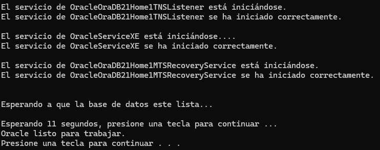</p>

**Un único script para arrancar o parar según el estado.**

En lugar de dos scripts, puede usarse uno solo que **detecta si Oracle está en marcha** y hace lo contrario: si está parado lo arranca, y si está en marcha lo para. Además, **pide los permisos de administrador por sí solo**, así que no necesita un acceso directo especial. Se crea igual que los anteriores, con el nombre `alternar_oracle.bat`.

`alternar_oracle.bat`:

```
@echo off
REM Arranca o para Oracle Database XE segun su estado actual.
REM Pide permisos de administrador por si solo.

REM 1. Si no tiene permisos de administrador, se vuelve a abrir pidiendolos.
net session >nul 2>&1
if errorlevel 1 (
    powershell -Command "Start-Process '%~f0' -Verb RunAs"
    exit /b
)

REM 2. Comprueba si la base de datos esta en marcha.
sc query OracleServiceXE | find "RUNNING" >nul
if errorlevel 1 goto arrancar

:parar
net stop OracleOraDB21Home1MTSRecoveryService
net stop OracleServiceXE
net stop OracleOraDB21Home1TNSListener
echo Servicios de Oracle detenidos.
goto fin

:arrancar
net start OracleOraDB21Home1TNSListener
net start OracleServiceXE
net start OracleOraDB21Home1MTSRecoveryService
echo Esperando a que la base de datos este lista...
timeout /t 30
echo Oracle listo para trabajar.

:fin
pause
```

Qué hace cada parte:

- **Bloque 1:** `net session` solo funciona con permisos de administrador. Si falla, el script se vuelve a abrir a sí mismo pidiendo esos permisos (aparece el aviso de Windows) y la ventana original se cierra.

- **Bloque 2:** `sc query` consulta el estado del servicio de la base de datos, y `find "RUNNING"` comprueba si está en marcha. Si no lo está, el script salta a la parte de arrancar; si lo está, sigue por la de parar.

- `:parar`, `:arrancar` y `:fin` son etiquetas: marcan los puntos a los que puede saltar el script con `goto`.

### 6.4. Comprobación final

Para confirmar que la configuración funciona, hay que comprobar que los servicios ya no arrancan solos con Windows y que los scripts los ponen en marcha correctamente.

1. **Reiniciar el equipo.**

2. **Comprobar que los servicios están parados.** En una terminal:

   ```
   sc.exe query OracleServiceXE
   ```

La línea **ESTADO** debe indicar **STOPPED** (detenido). También se puede ver en `services.msc`.

3. **Comprobar que, con los servicios parados, no hay conexión.** Al intentar entrar con SQL\*Plus:

   ```
   sqlplus / as sysdba
   ```

debe aparecer un error de conexión (ORA-12560). Es el comportamiento esperado: el servidor no está en marcha. Para salir, pulsar **Intro** hasta volver a la terminal o cerrar la ventana.

4. **Arrancar los servicios** y esperar a que indique que Oracle está listo. Comprobar la conexión:

   ```
   sqlplus / as sysdba
   ```

Esta vez debe entrar sin problemas y mostrar el indicador `SQL>`. Salir con `EXIT`.

Si los cuatro pasos dan el resultado indicado, la configuración del inicio manual es correcta.

## 7. Usuario de trabajo

Las cuentas creadas durante la instalación (SYS, SYSTEM y PDBADMIN) son de **administración**: tienen permiso para hacer cualquier cosa, incluido romper la base de datos. Para el trabajo diario conviene crear un **usuario con los permisos justos**, igual que en Windows no se trabaja a diario con la cuenta de administrador. Es lo que se llama **principio de mínimo privilegio**: cada usuario tiene solo los permisos necesarios, y se le añaden más si hace falta.

El usuario se crea en **XEPDB1**, la base de datos de trabajo, y no en el contenedor raíz (XE), reservado a la administración general. Aquí el usuario es `jordi`; conviene usar un nombre propio, sencillo y sin espacios ni tildes.

### 7.1. Conectarse a XEPDB1 como administrador

Para crear el usuario hay que conectarse a XEPDB1 con una cuenta de administración. Se usa **SYSTEM**, el administrador habitual.

1. Abrir la terminal (no hace falta que sea como administrador).

2. Conectarse indicando el usuario y la dirección de XEPDB1:

   ```
   sqlplus system@localhost:1521/XEPDB1
   ```

La dirección tiene tres partes: el equipo (localhost, el propio ordenador), el puerto del servicio de escucha (1521) y la base de datos a la que se quiere entrar (XEPDB1).

3. Escribir la contraseña de la instalación cuando la pida. Por seguridad, **no se ve nada mientras se escribe**.

4. Comprobar que se está dentro de XEPDB1, y no en el contenedor raíz:

   ```
   SHOW CON_NAME
   ```

<p align="center">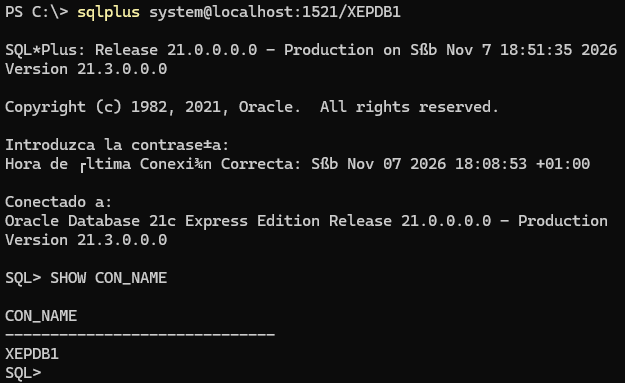</p>

El resultado debe ser **XEPDB1**.

> **Nota. Alternativa gráfica.** Esta sección también puede hacerse con SQL Developer, desde su hoja de trabajo o con su asistente de creación de usuarios, instalándolo antes según la sección 8. Aun así, se recomienda la terminal: funciona siempre, incluso sin entorno gráfico, las órdenes se pueden copiar y repetir tal cual, y se entiende mejor lo que se está haciendo.

### 7.2. Crear el usuario y darle permisos

> **Nota:** algunas órdenes ocupan varias líneas. Al pulsar Intro al final de cada una, se muestra un número indicando que espera la siguiente: **es normal**. La orden se ejecuta al pulsar Intro tras la línea que termina en punto y coma (;)

**Crear el usuario**

Hay dos formas de hacerlo, que solo se diferencian en cómo se escribe la contraseña.

**Opción A: con la contraseña definitiva directamente**

```
CREATE USER jordi IDENTIFIED BY "contraseña_de_jordi"
DEFAULT TABLESPACE users
QUOTA UNLIMITED ON users;
```

Es la forma más directa, con una limitación: **la contraseña queda a la vista en la pantalla** mientras se escribe. Es aceptable si se trabaja a solas y no se van a hacer capturas, ya que SQL\*Plus no guarda por defecto un historial de las órdenes en ningún fichero. Si hay alguien delante o se va a capturar la pantalla, es mejor la opción B.

**Opción B: con una contraseña provisional y cambiándola de forma oculta**

```
CREATE USER jordi IDENTIFIED BY "Provisional1"
DEFAULT TABLESPACE users
QUOTA UNLIMITED ON users;
PASSWORD jordi
```

La orden `PASSWORD` es propia de SQL\*Plus: pide la contraseña nueva dos veces, para confirmarla, **sin mostrarla** mientras se escribe, igual que al conectarse.

**Qué significa cada parte** (válido para las dos opciones):

- `IDENTIFIED BY` fija la contraseña del usuario. Debe ser **distinta** de la de las cuentas de administración; si no, quien conozca una conoce las dos. Va entre comillas dobles, y conviene evitar la arroba (@), porque en las órdenes de conexión se usa para separar el usuario de la dirección.

- `DEFAULT TABLESPACE users` indica dónde se guardarán sus tablas. Un *tablespace* es un espacio de almacenamiento dentro de la base de datos, algo así como una carpeta.

<p align="center">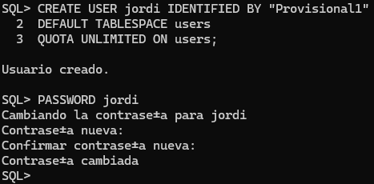</p>

- `QUOTA UNLIMITED ON users` le permite **ocupar espacio** en ese *tablespace*. Sin esta línea, el usuario podría crear tablas, pero fallaría al guardar datos en ellas.

**Darle permisos**

```
GRANT CREATE SESSION, CREATE TABLE, CREATE VIEW, CREATE SEQUENCE, CREATE PROCEDURE TO jordi;
```

Qué permite cada uno:

- `CREATE SESSION`: **conectarse** a la base de datos. Sin este permiso, el usuario existe pero no puede entrar.

- `CREATE TABLE`: crear tablas.

- `CREATE VIEW`: crear vistas, que son consultas guardadas que se usan como si fueran tablas.

- `CREATE SEQUENCE`: crear secuencias, que generan números consecutivos, por ejemplo para identificadores.

- `CREATE PROCEDURE`: crear procedimientos y funciones, pequeños programas guardados en la base de datos.

Si todo va bien, Oracle responde con un mensaje de confirmación tras cada orden.

Para terminar, salir de la sesión de `SYSTEM`:

```
EXIT
```

### 7.3. Comprobar que el usuario funciona

Para verificar que el usuario puede conectarse y trabajar, se crea una tabla, se guardan datos en ella y se consultan.

1. Conectarse con el nuevo usuario a XEPDB1 y escribir su contraseña cuando la pida:

   ```
   sqlplus jordi@localhost:1521/XEPDB1
   ```

2. Comprobar con qué usuario se ha entrado:

   ```
   SHOW USER
   ```

Debe responder `USER es "JORDI"`. Aparece en mayúsculas porque Oracle guarda así los nombres escritos sin comillas.

3. Crear una tabla de prueba:

   ```
   CREATE TABLE prueba (id NUMBER, texto VARCHAR2(50));
   ```

4. Guardar dos filas y **confirmar** los cambios:

   ```
   INSERT INTO prueba VALUES (1, 'Primera fila');
   INSERT INTO prueba VALUES (2, 'Segunda fila');
   COMMIT;
   ```

`COMMIT` hace que los cambios se guarden de forma definitiva. Sin él, se perderían al cerrar la sesión.

5. Consultar la tabla:

   ```
   SELECT * FROM prueba;
   ```

Deben aparecer las dos filas.

6. *(Opcional)* Borrar la tabla de prueba, si no se va a usar más:

   ```
   DROP TABLE prueba;
   ```

7. Salir:

   ```
   EXIT
   ```

<p align="center">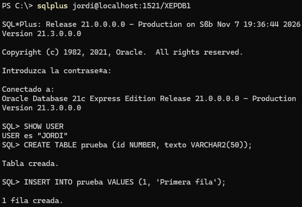</p>

Si todos los pasos funcionan, el usuario está correctamente creado, puede conectarse, crear tablas y guardar datos.

<p align="center">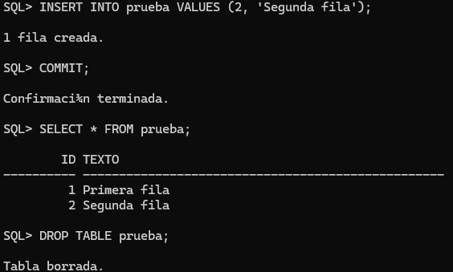</p>

### 7.4. Ampliar, quitar o revisar permisos más adelante

Los permisos no son definitivos: se pueden **añadir o quitar en cualquier momento**. Lo hace un administrador, conectado como SYSTEM a XEPDB1, igual que en el apartado 7.1:

```
sqlplus system@localhost:1521/XEPDB1
```

**Dar un permiso nuevo**, por ejemplo para crear disparadores (*triggers*):

```
GRANT CREATE TRIGGER TO jordi;
```

**Quitar un permiso:**

```
REVOKE CREATE TRIGGER FROM jordi;
```

**Ver qué permisos tiene el usuario:**

```
SELECT privilege FROM dba_sys_privs WHERE grantee = 'JORDI';
```

El nombre va en mayúsculas porque, entre comillas simples, Oracle distingue mayúsculas de minúsculas y guarda los nombres de usuario en mayúsculas.

**Otras operaciones habituales:**

- **Desbloquear la cuenta**, si se bloquea tras varios intentos fallidos de contraseña:

```
ALTER USER jordi ACCOUNT UNLOCK;
```

- **Cambiar su contraseña** sin que se vea en pantalla:

```
PASSWORD jordi
```

- **Borrar el usuario y todo lo que haya creado**, para empezar de cero:

```
DROP USER jordi CASCADE;
```

Si una tarea requiere más permisos de los que tiene el usuario, hay dos opciones: **concedérselos** con GRANT o **hacer esa tarea como SYSTEM**. Lo recomendable es seguir trabajando con el usuario propio y usar la cuenta de administración solo cuando haga falta.

## 8. SQL Developer

SQL Developer es el programa cliente gráfico de Oracle: permite conectarse a la base de datos, ver sus objetos (tablas, vistas, usuarios…) y ejecutar órdenes SQL en una hoja de trabajo, con colores, autocompletado y resultados en forma de tabla. **No necesita instalación**: basta con descomprimirlo y ejecutarlo.

### 8.1. Descomprimir el programa

1. Hacer clic derecho sobre el ZIP de SQL Developer descargado y elegir **Extraer todo**.

2. Como destino, escribir:

   ```
   C:\oracle
   ```

El ZIP ya contiene una carpeta llamada `sqldeveloper`, así que el programa quedará en `C:\oracle\sqldeveloper`.

3. Para tenerlo a mano, crear un acceso directo: abrir `C:\oracle\sqldeveloper`, hacer clic derecho sobre `sqldeveloper.exe` → **Mostrar más opciones** → **Enviar a** → **Escritorio (crear acceso directo)**.

### 8.2. Primer arranque

1. Hacer doble clic en el acceso directo de **sqldeveloper.exe**. La primera vez tarda un poco más en abrirse.

2. Si pregunta si se desean **importar preferencias** de una instalación anterior, responder **No**.

3. Si aparece una ventana sobre el **seguimiento de uso** (*Oracle Usage Tracking*), se puede desmarcar la casilla para no enviar datos de uso a Oracle, y pulsar **Aceptar**.

4. Si aparece una advertencia del cortafuegos, permitir.

Al terminar se abre la ventana principal, con el panel **Conexiones** a la izquierda.

**Si SQL Developer no arranca:**

- Si pide la **ruta de un JDK** (Java), se ha descargado la versión sin Java incluido: hay que descargar la versión con JDK incluido o instalar Java aparte.

- Si se cierra sin mostrar nada, Oracle documenta un problema conocido en Windows relacionado con el fichero MSVCR100.dll. Se explica en la sección de incidencias.

### 8.3. Conexión como administrador

Una **conexión** guarda los datos necesarios para entrar en una base de datos con un usuario concreto. Primero se crea una para el administrador, SYSTEM, en XEPDB1.

1. En el panel **Conexiones**, pulsar el botón **+** (Nueva conexión).

2. Rellenar los datos:

   - **Name** (nombre de la conexión): `XE_system`. Es solo un nombre para reconocerla en la lista.

   - **Usuario:** `system`

   - **Contraseña:** la de la instalación.

   - **Guardar contraseña:** opcional. Es cómodo, pero cualquiera podrá entrar como administrador.

   - **Tipo de conexión:** Básico

   - **Nombre del host:** `localhost`

   - **Puerto:** `1521`

   - Marcar **Nombre del servicio** (no SID) y escribir: `XEPDB1`

3. Pulsar **Probar**. En la parte inferior izquierda debe aparecer **Estado: Correcto**.

4. Pulsar **Guardar** y después **Conectar**.

La conexión aparece en el panel izquierdo. Al desplegarla se ven los objetos de la base de datos: tablas, vistas, otros usuarios…

<p align="center">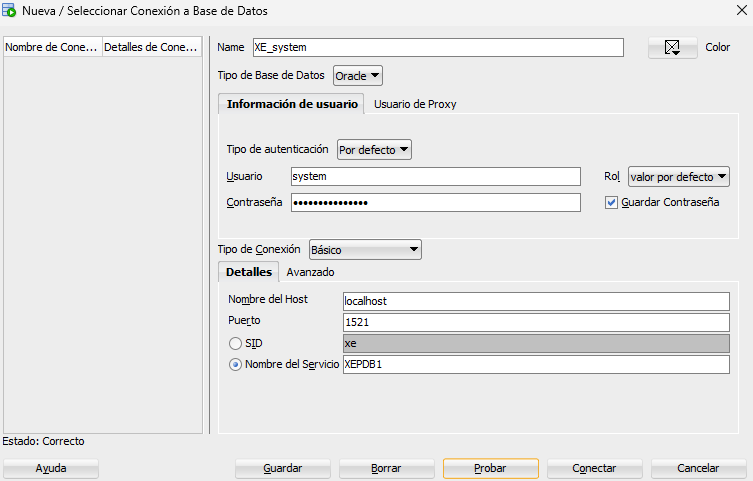</p>

> **Nota:** se usa *Nombre del servicio* porque XEPDB1 es una base de datos conectable (PDB) y no tiene SID propio: el listener la ofrece como servicio. Es la base de datos de trabajo que crea el instalador y donde está el usuario de trabajo (sección 7). El SID (XE) solo da acceso al contenedor principal.

> **Nota: ¿y si se quiere otra base de datos?** En Oracle, lo que en MySQL sería crear una base de datos (`CREATE DATABASE`) se consigue creando un usuario: cada usuario tiene su espacio para sus tablas, llamado **esquema**. Para un proyecto nuevo basta con crear otro usuario en XEPDB1, igual que el de la sección 7. Los nombres de usuario tienen como máximo 30 caracteres, empiezan por letra y solo llevan letras, números o \_ (sin espacios, tildes ni ñ).

### 8.4. Conexión con el usuario de trabajo y prueba

Para el trabajo diario se usa el usuario creado en la sección 7, no el administrador.

1. Pulsar **+** (Nueva conexión) y rellenar como en 8.3, cambiando solo:

   - **Name:** `XE_jordi`

   - **Usuario:** `jordi`

   - **Contraseña:** la del usuario de trabajo.

   - **Volver a marcar Nombre del servicio** y escribir `XEPDB1`. El formulario vuelve a marcar *SID* por defecto, y con SID se obtiene un error de usuario o contraseña (ORA-01017).

2. Pulsar **Probar** y comprobar que aparece **Estado: Correcto**. Después, **Guardar** y **Conectar**.

3. Se abre una **hoja de trabajo** (Worksheet). Escribir:

   ```
   SELECT user, sys_context('USERENV','CON_NAME') AS contenedor FROM dual;
   ```

4. Pulsar **Ejecutar sentencia** (el triángulo verde) o **Ctrl+Intro**. En **Resultado de la consulta** debe aparecer JORDI y XEPDB1.

<p align="center">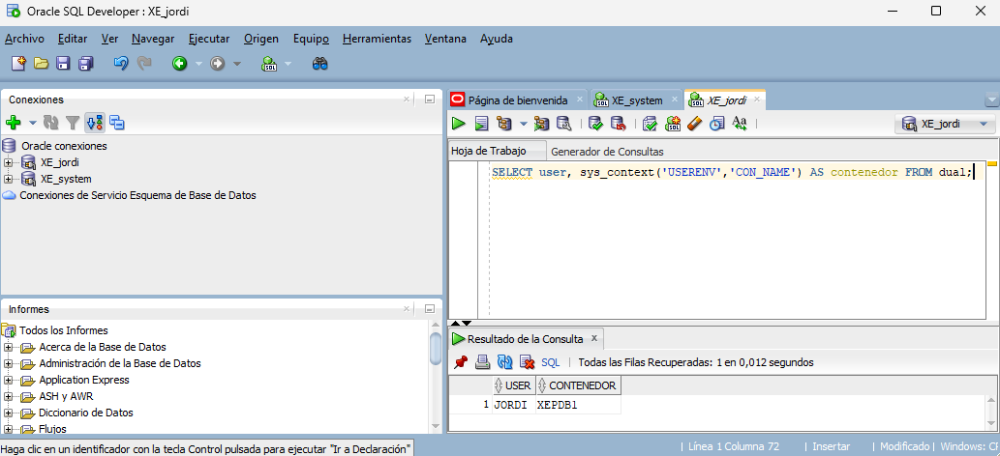</p>

Con esto se comprueba que SQL Developer conecta al servidor con el usuario de trabajo y en la BD correcta.

## 9. Incidencias y ficheros de registro

Esta sección recoge los errores más habituales al conectarse a Oracle y las incidencias que aparecieron durante la instalación, cada uno con su causa y su solución. Al final se indica dónde guarda Oracle sus ficheros de registro, que son la primera fuente para diagnosticar cualquier problema.

### 9.1. Errores de conexión habituales

Los errores de Oracle se identifican por un código (`ORA-xxxxx`) seguido de un texto. El código es lo importante: con él se puede buscar información aunque el texto aparezca en otro idioma.

- `ORA-12560`**: error del adaptador del protocolo.** Aparece al ejecutar `sqlplus / as sysdba` con los servicios parados.
  Solución: arrancar los servicios (sección 6).

- `ORA-12541`**: no hay ningún listener.** El listener está parado, así que no se puede conectar a través de la red, aunque sea en el mismo equipo.
  Solución: arrancarlo con `lsnrctl start` o con el script de la sección 6. Mientras tanto, `sqlplus / as sysdba` sigue funcionando, porque la conexión local no pasa por el listener.

- `ORA-12514`**: el listener no conoce actualmente el servicio solicitado.** El nombre del servicio es incorrecto (por ejemplo, XEPDB2 en vez de XEPDB1). También aparece durante el primer minuto después de arrancar el listener, mientras la base de datos se registra en él.
  Solución: revisar el nombre del servicio o esperar un poco y volver a intentarlo.

- `ORA-01017`**: nombre de usuario/contraseña no válidos.** La causa más evidente es una contraseña mal escrita; recordar que distingue mayúsculas y minúsculas. Pero también aparece si se conecta al contenedor equivocado: el usuario de trabajo solo existe en XEPDB1. En SQL Developer pasa si queda marcado *SID* en lugar de *Nombre del servicio* (sección 8.4).

- `ORA-28000`**: la cuenta está bloqueada.** La cuenta se ha bloqueado, a mano o por varios intentos fallidos. Solución: como administrador en XEPDB1, `ALTER USER usuario ACCOUNT UNLOCK;`

- `ORA-01918`**: el usuario no existe.** Pasa al gestionar un usuario estando en el contenedor principal (`CDB$ROOT`) en lugar de en XEPDB1. Se comprueba con `SHOW CON_NAME`.
  Solución: `ALTER SESSION SET CONTAINER = XEPDB1;` o volver a conectar con `sqlplus system@localhost:1521/XEPDB1`.

- `ORA-01031`**: privilegios insuficientes.** El usuario intenta algo para lo que no tiene permiso; por ejemplo, el usuario de trabajo crea otro usuario. El administrador debe conceder el privilegio con `GRANT` (sección 7.4).

- **SQL Developer: «IO Error: The Network Adapter could not establish the connection».** SQL Developer no llega al listener: está parado, o el host o el puerto son incorrectos.
  Solución: comprobar que los servicios están en marcha y que el puerto es 1521.

> **Nota:** si los mensajes de SQL\*Plus muestran símbolos raros en lugar de tildes (¾, ±…), antes de abrir `sqlplus` hay que escribir en la terminal `set NLS_LANG=SPANISH_SPAIN.WE8PC850` (CMD) o `$env:NLS_LANG="SPANISH_SPAIN.WE8PC850"` (PowerShell). El cambio solo afecta a esa ventana.

### 9.2. Incidencias durante la instalación y la configuración

Problemas comunes detectados durante la instalación y puesta en marcha del sistema, con su causa y su solución.

- **La instalación parece bloqueada.** La instalación tarda alrededor de 10 minutos, y durante ese tiempo el Administrador de tareas puede no mostrar actividad ni del instalador ni de la ventana de configuración. No está colgada: hay que esperar y **no cancelar**.

- **Se cierra la pantalla final del instalador sin anotar los datos.** Esa pantalla muestra los datos de conexión, pero se pueden recuperar. Con `lsnrctl status` se ven el puerto (1521) y los servicios (`XE` y `XEPDB1`). Para el puerto de EM Express, desde `sqlplus / as sysdba` se ejecuta `SELECT dbms_xdb_config.gethttpsport FROM dual;` (5500).

- **El instalador se descomprime por error en la carpeta de instalación.** Oracle se instala igualmente, pero los ficheros del instalador quedan mezclados con los de Oracle. Para limpiarlo, se comparan con el contenido del ZIP y se borran **solo** esos elementos. No hay que tocar las carpetas creadas por la instalación. Para evitarlo, se descomprime siempre en una carpeta temporal aparte (sección 3).

- `sc query` **no devuelve nada en PowerShell.** En PowerShell, `sc` es un alias de otro comando, `Set-Content`. No consulta servicios y además crea un fichero llamado `query` en la carpeta actual. Solución: usar `sc.exe query OracleServiceXE` o `Get-Service Oracle*`, y borrar el fichero creado. En CMD y en los scripts `.bat`, `sc` funciona con normalidad.

- **Error de sistema 1297 en el servicio OracleVssWriterXE.** Este servicio no arranca, y Windows indica que *«requiere un privilegio que no existe en la configuración de la cuenta de servicio»*. El Visor de eventos (Registros de Windows → Sistema) repite el mismo texto sin decir qué privilegio falta. El servicio solo sirve para incluir la base de datos en las copias de seguridad de Windows (VSS) y no es necesario para trabajar. Se deja tal como lo configura el instalador y no se incluye en los scripts (sección 6).

- **Problema conocido: SQL Developer no arranca.** Oracle documenta que puede ocurrir si el sistema encuentra una versión de 32 bits de la biblioteca `MSVCR100.dll`. No se dio en esta instalación. Si ocurre, la solución está en la documentación de SQL Developer.

### 9.3. Ficheros de registro

Cuando un mensaje de error no basta, hay que consultar los registros que guardan Oracle y Windows. Son ficheros de texto que se abren con el Bloc de notas. Las entradas más recientes están al final, y conviene fijarse en la fecha y la hora para encontrar las líneas relevantes.

- **Alert log de la base de datos.** Es el diario de Oracle: arranques, paradas y errores graves.

  ```
  C:\oracle\diag\rdbms\xe\xe\trace\alert_XE.log
  ```

  Si no está ahí, la ruta se obtiene desde `sqlplus / as sysdba` con:

  ```
  SELECT value FROM v$diag_info WHERE name = 'Diag Trace';
  ```

  Un arranque correcto termina con `Completed: alter database open`. Los errores se localizan buscando `ORA-`.

- **Log del listener.** Registra cada intento de conexión. Su ruta aparece en la línea **Log del Listener** de `lsnrctl status`. Hay una versión en texto plano, más fácil de leer, en `...\listener\trace\listener.log`.

- **Logs de la instalación.** Están en `C:\oracle\cfgtoollogs`: `dbca` guarda la creación de la base de datos y `netca`, la configuración del listener.

- **Visor de eventos de Windows** (`eventvwr.msc`). Los fallos al arrancar servicios aparecen en *Registros de Windows* → *Sistema*. Ahí quedó registrado el error 1297 del apartado 9.2.

**Ejemplo real interpretado** (fragmento del alert log de esta instalación):

```
18:20:27  SHUTDOWN: waiting for active calls to complete.
18:29:12  Starting ORACLE instance (normal)
          Beginning crash recovery of 1 threads
          Completed crash recovery
```

La parada no llegó a completarse, porque falta la línea `Instance shutdown complete`: se reinició el equipo mientras la base de datos se cerraba. En el arranque siguiente, Oracle se recuperó solo usando sus *redo logs*. Durante la instalación también aparecen errores como `ORA-19625` u `ORA-00313`, que son normales mientras se crea la base de datos. Por eso, un `ORA-` no siempre es una avería: hay que fijarse en el contexto y en si después aparece `Completed`.

## 10. Anexos

### 10.1. Desinstalación

**Desinstalar Oracle XE elimina la base de datos y sus datos.** Si hay algo que conservar, hay que exportarlo antes.

**Oracle Database XE**

1. Parar los servicios de Oracle (sección 6.2 o script `parar_oracle.bat`).

2. Ir a **Configuración** → **Aplicaciones** → **Aplicaciones instaladas**, buscar **Oracle Database Express Edition** y pulsar **Desinstalar**.

3. Reiniciar el equipo.

4. Si después del reinicio queda la carpeta `C:\oracle`, se puede borrar a mano. Los scripts de la sección 6 se borran con ella; hay que copiarlos antes si se quieren conservar.

**SQL Developer**

No tiene instalador, así que basta con borrar su carpeta (`C:\oracle\sqldeveloper`) y el acceso directo, si se creó. Sus preferencias y conexiones guardadas se encuentran en `%APPDATA%\SQL Developer`, y también se pueden borrar.

**Nota:** si algo sale mal y el equipo queda inestable, queda el **punto de restauración** creado en la sección 3.

### 10.2. Conceptos básicos: CDB y PDB

Oracle organiza las bases de datos como un **edificio con pisos**. Entender esta idea evita la mayoría de los errores de conexión de la sección 9.

- **Instancia.** Es el Oracle en ejecución: los procesos y la memoria que gestionan los datos. Se identifica por su **SID**, que en XE es siempre XE.

- **CDB (base de datos contenedora).** Es el **edificio**: contiene todo lo demás. Su parte principal, llamada **CDB$ROOT**, guarda la información interna de Oracle y no se usa para los datos de trabajo.

- **PDB (base de datos conectable).** Es un **piso** del edificio: una base de datos independiente, con sus propios usuarios y tablas. El instalador crea una, **XEPDB1**, que es donde se trabaja. XE admite hasta 16 PDB.

- **PDB$SEED.** Es una plantilla de solo lectura que Oracle usa para crear PDB nuevas. No se toca.

- **Servicio.** Es el nombre con el que se llega a cada base de datos a través del listener. Por eso, para conectarse a XEPDB1 se usa *Nombre del servicio* y no SID.

- **Usuarios comunes y locales.** Los usuarios creados en el contenedor principal son **comunes**: existen en todos los pisos y su nombre debe empezar por C##. Los creados dentro de una PDB son **locales**: solo existen en ella. El usuario de trabajo de la sección 7 es local de XEPDB1. Por eso no se encuentra si se busca desde el contenedor principal (ORA-01918, ORA-01017).

- **SYS, SYSTEM y PDBADMIN.** SYS y SYSTEM son los administradores de todo el edificio. PDBADMIN es el administrador de XEPDB1. Los tres comparten la contraseña elegida durante la instalación.
